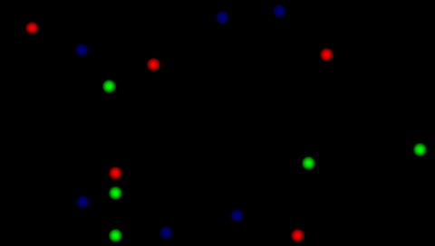

## Generating and Drawing Particles Using the Virtual Mobile Engine

In this article, we will see how the Virtual Mobile Engine (VME) can be used to generate moving particles on its own, directly to the frame buffer.

## To Begin With

Recently, we saw that we now have a toolkit that allows us to describe kernels meant to be processed by the Virtual Mobile Engine.

As a reminder, the VME is an accelerator hosted by the Media Engine, which I would define as a stream-based, spatially parallel processing engine. This means we can have several streams, each flowing word by word in an optimal way over different Functional Units that run in parallel to each other.

A kernel can be sent to the VME and then requested to be executed, but we can also reconfigure it dynamically without having to upload a full kernel again. This gives us fine-grained control from the Media Engine at execution time.

The VME is the chip that serves as the core unit for decoding, audio and general-purpose signal processing tasks. We can actually draw a parallel with the academic CGRA (Coarse-Grained Reconfigurable Array). In fact, the reverse engineering work and the trial-and-error testing were carried out with this idea in mind, supposing that the VME could belong to this type of hardware. Even if it wasn't certain that this was the right way to go, in the end it fits very well.

## Experimental Motivation

As a follow-up to what was said earlier, the Next-Level toolkit is a project that introduces a language specially designed to describe and integrate VME kernels into your .C or .CPP code, built to produce the code executed on the Media Engine.

In the context of our exercise, the Media Engine (the host CPU) is reduced to managing the loading and transfer of data between memory and the VME. All the logic is left to the VME itself. The main CPU for its part, just sets up the frame buffer in a shared memory area and runs a loop to keep the application running until HOME is pressed.

To clarify a bit, the VME executes the kernels, meaning the logic, while the Media Engine handles the pipeline. The latter acts more like an orchestrator with a simple role, which is to link the data between the different parts of the pipeline. The SC, after configuring the necessary, enters a loop that just waits for the HOME button to be pressed in order to exit.

This was done to demonstrate that the VME can serve as the piece of hardware acting as the main processing unit in a Homebrew project.

And additionnaly this experiment takes advantage of the new VME2 Next-Level Toolkit, which is available here:  
[VME2 Next-Level Toolkit](https://github.com/Th6uD1nk/vme2-next-level)

## The Sample Code Itself

The idea here is to draw and move particles over a buffer to be displayed on the screen. 16 particles are drawn, each one moving along its own straight line at its own speed. When a particle leaves the screen, it comes back at the start of the same line and travels along it again.

To make this possible, the VME has to rely on several kernels that describe the logic it has to process. Together, those kernels produce a pipeline in which each kernel has its own role and contributes to the construction of the final image to be displayed.

Let's enter into a slightly more technical aspect with the list of the kernels, by name and role, used to build the pipeline:

### Advance
'Advance' is the kernel that increments the phase of each particle.

### Place
'Place' is the kernel that calculates the position of each particle.

### ProfileX
'ProfileX' is the kernel that allows us to determine how much each particle contributes to the image horizontally (across the columns).

### MakeDy
'MakeDy' is the one that calculates how much each particle contributes to the image vertically. Together with the 'ProfileX' kernel, it determines how each particle's color spreads across the image based on its position.

### LoadResident
'LoadResident' is the one that takes the previous data of the particles and loads it into the scratchpad, split across the 4 main areas (top0 to top3), with 4 particles in each area.

### The Renderers
'RenderFirst', 'RenderMiddle' and 'RenderLast' are the final three kernels, which calculate the brightness contribution of each particle and add it to the existing pixel values. They process two rows in parallel, accumulating the contributions of all 16 particles before moving on to the next two rows. (Note that this part could be improved.)

Reading it like this, I admit that it might be hard to understand exactly what this pipeline does, or why we need to process things that way. In fact, this is because the constraints on the VME are not the same as the ones we find using the CPU or the VFPU, which is directly integrated into the MIPS pipeline. Here we have a very separate engine that doesn't loop in a classical way, processing data through streams over what we call a DataPath. Explaining what a DataPath is falls outside the scope and intent of this article, so I recommend that you research and read on that subject to get a better understanding of it.

That said, you can take a look at the result in the video anyway:  

For me, the possibilities are enormous, since a kernel (you'll sometimes see the term context) executed on the VME doesn't necessarily need to be waited on by its host CPU, which gives us the opportunity to distribute the workload more widely in our homebrew projects.

Well, we have reached the end of the article on this particles experiment with the VME. If you'd like to see more about it, get more technical information, and/or see how the code is written, you can take a look at it and refer to the README here:  
[VMEG Particles](https://github.com/Th6uD1nk/vmeg-samples/tree/main/vmegc-rgb-particles)

Thanks for reading,

m-c/d
